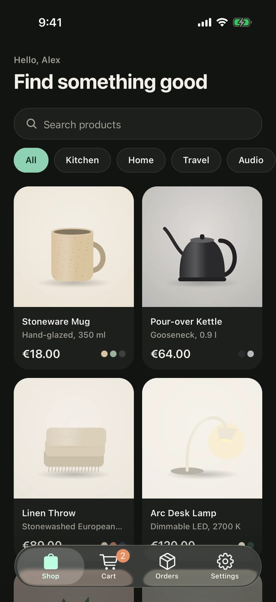
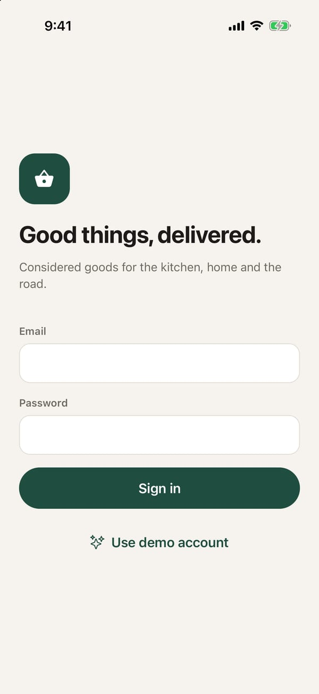
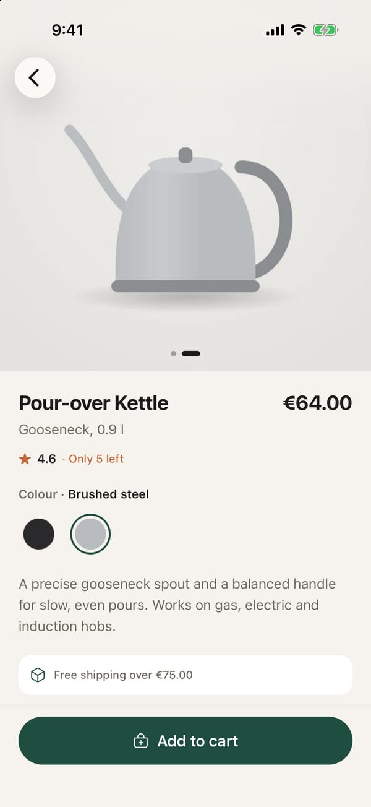
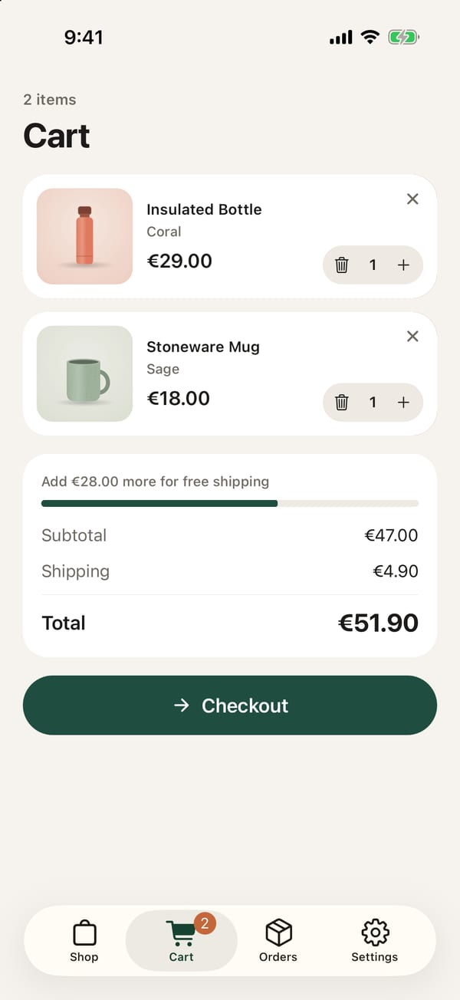
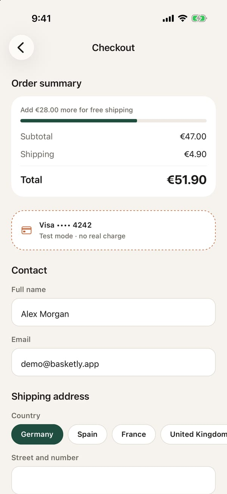
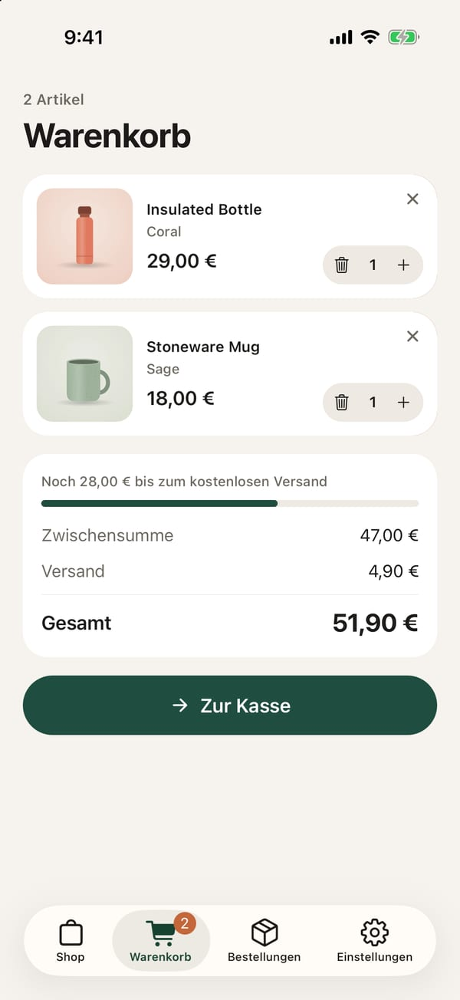
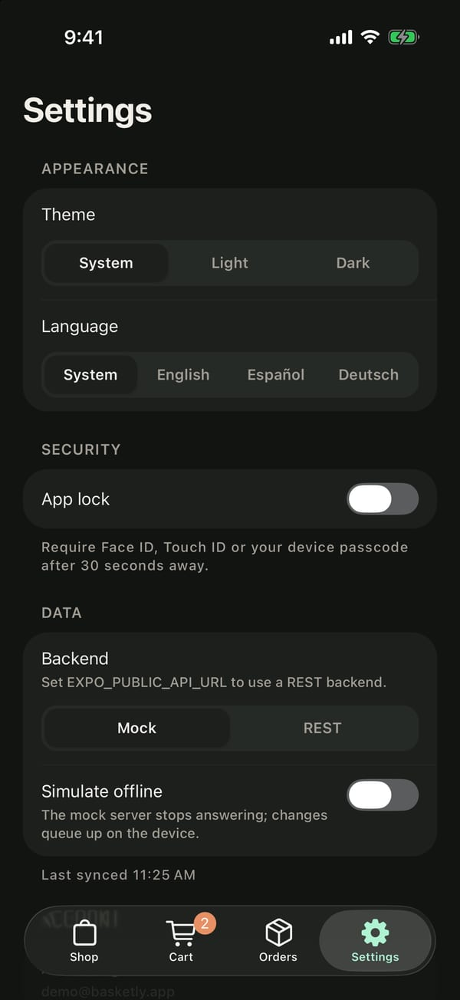
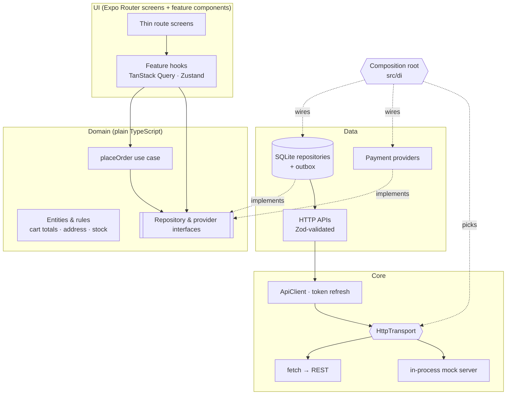
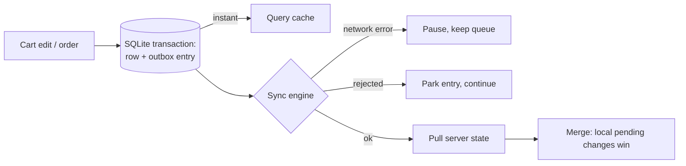

<div align="center">



# Basketly

**An offline-first shopping app built with React Native and Expo.**

Clean architecture · in-process mock backend · offline cart with sync queue · encrypted database · app lock · custom native module · 3 languages · light & dark themes


</div>

Basketly is a small store for kitchen, home and travel goods. It is a reference implementation of a
production React Native app: layered feature folders, a backend chosen by configuration, a local
SQLite database as the source of truth with a queue that syncs when the device is back online, and
security measures suited to accounts, addresses and payments.

---

## Contents

- [Highlights](#highlights)
- [Screenshots](#screenshots)
- [Running](#running)
- [Why Expo](#why-expo)
- [Architecture](#architecture)
- [Offline-first sync](#offline-first-sync)
- [Payments](#payments)
- [Security](#security)
- [Localization and theming](#localization-and-theming)
- [Testing and quality](#testing-and-quality)
- [Tech stack](#tech-stack)
- [Project structure](#project-structure)
- [REST API contract](#rest-api-contract)
- [Production notes](#production-notes)
- [License](#license)

---

## Highlights

| Area                   | Details                                                                                                                                                                                                        |
| ---------------------- | -------------------------------------------------------------------------------------------------------------------------------------------------------------------------------------------------------------- |
| **Offline-first**      | Cart and orders live in an encrypted SQLite database. Every write is applied locally and queued; the queue uploads in order when the connection returns.                                                       |
| **Swappable backend**  | The app only talks to an `HttpTransport`. Demo mode plugs in an in-process mock server that speaks the same HTTP contract, so validation, token refresh and sync run exactly as they would against a real API. |
| **Pluggable payments** | Checkout depends on a `PaymentProvider` interface. A new provider is one class plus one registry entry; the UI and the order flow do not change.                                                               |
| **Security**           | Tokens in Keychain/Keystore, SQLCipher database with a generated key, single-flight token refresh, HTTPS-only config, biometric app lock and a custom native privacy screen.                                   |
| **Native capability**  | Development builds with a custom Expo module written in Swift and Kotlin.                                                                                                                                      |
| **Tested**             | 49 Jest tests: domain rules, sync engine and repositories on real SQLite (WebAssembly), token refresh, the mock server and an end-to-end offline order flow.                                                   |
| **International**      | English, Spanish, German, with locale-aware currency (`€51.90` / `51,90 €`), light and dark themes.                                                                                                            |

---

## Screenshots

> Captured from the development build on an iPhone 17 Pro simulator.

|                                         Sign in                                          |                                                    Catalogue (dark)                                                    |                                                  Product                                                   |
| :--------------------------------------------------------------------------------------: | :--------------------------------------------------------------------------------------------------------------------: | :--------------------------------------------------------------------------------------------------------: |
|  |  |  |
|                                   One-tap demo account                                   |                                        Search, category filter, FlashList grid                                         |                              Gallery synced to the colour picker, stock rules                              |

|                                                   Cart                                                    |                                                            Checkout                                                             |                                            Cart (German)                                             |
| :-------------------------------------------------------------------------------------------------------: | :-----------------------------------------------------------------------------------------------------------------------------: | :--------------------------------------------------------------------------------------------------: |
|  |  |  |
|                               Optimistic quantity changes, swipe to delete                                |                                            Validated address form, pluggable payment                                            |                                Translations and number formats change                                |



Settings: theme, language, app lock, mock or REST backend, and a switch that simulates going offline.

---

## Running

**Requirements:** Node 22+, pnpm 11, Xcode 26 for iOS, Android Studio for Android.
The app uses native modules, so it runs as a development build, not in Expo Go.

```bash
pnpm install
pnpm ios          # prebuild + build + run on a simulator
pnpm android      # same for Android
pnpm start        # Metro only, for an already installed development build
```

Tap **Use demo account** (`demo@basketly.app` / `basketly-demo`). Everything runs against the
built-in mock server; nothing leaves the device.

**Things to try**

1. Settings → _Simulate offline_, add something to the cart, and watch the banner count queued changes. Switch it off: the queue uploads.
2. Switch the language to _Deutsch_ and the theme to _Dark_.
3. Open `basketly://product/insulated-bottle` from Safari: deep links go straight to a product.
4. Enable _App lock_, background the app for 30 seconds and come back.

### Configuration

Copy `.env.example` to `.env.local`. Only `EXPO_PUBLIC_*` values reach the bundle, and they are validated with Zod at startup.

| Key                            | Values                                                                    | Default |
| ------------------------------ | ------------------------------------------------------------------------- | ------- |
| `EXPO_PUBLIC_BACKEND`          | `mock` \| `rest`                                                          | `mock`  |
| `EXPO_PUBLIC_API_URL`          | `https://…` (required for `rest`; `http://localhost` only in development) |         |
| `EXPO_PUBLIC_PAYMENT_PROVIDER` | key of a registered provider                                              | `mock`  |

### Native builds

`ios/` and `android/` are generated by `expo prebuild` (Continuous Native Generation) and are not
committed. Open `ios/Basketly.xcworkspace` in Xcode or `android/` in Android Studio after
`pnpm prebuild` to build locally. [`eas.json`](eas.json) has development, preview and production
profiles for EAS Build; it is optional.

---

## Why Expo

The React Native team recommends starting new apps with a framework, and Expo is that framework.
This project uses it the way a production team would:

- **Development builds and prebuild**, not Expo Go, so any native code can be added.
- **A custom native module** ([`modules/privacy-screen`](modules/privacy-screen)) written with the Expo Modules API in Swift and Kotlin.
- **No lock-in:** `expo prebuild` produces ordinary Xcode and Gradle projects, and EAS is optional.
- **New Architecture, Hermes and the React Compiler** are on.

---

## Architecture



- **Domain** (`features/*/domain`) has no React, Expo or storage imports; an ESLint rule enforces it.
  It holds the cart rules, address validation (Zod schemas with translation keys as messages),
  stock rules, and repository/provider interfaces.
- **Use cases only where there is logic.** `placeOrder` takes payment, builds the order and records
  it. Everything else (adding to the cart, listing products) goes straight from a hook to a
  repository; a use case there would only forward the call.
- **Data** implements the interfaces: SQLite repositories that write to the outbox in the same
  transaction, and thin API classes that parse every response with Zod.
- **Server state vs client state:** TanStack Query owns everything that comes from a repository
  (products, cart, orders), with optimistic updates for cart edits. Zustand holds UI state only:
  catalogue filters, session status, preferences (persisted to MMKV) and the sync status.
- **Composition root:** [`src/di/container.ts`](src/di/container.ts) is the only file that knows
  concrete classes. It is passed through React context, and tests build it with an in-memory
  database and a mock transport.
- **Feature boundaries:** screens import features through their `index.ts`; internals are off limits (lint rule).

---

## Offline-first sync



- **Reads come from the device.** The catalogue is cached by TanStack Query's persister (MMKV); cart and orders are SQLite tables.
- **One outbox entry per entity.** Ten taps on "+" produce one upload, not ten.
- **Edits during an upload are kept:** an entry is removed only if its version did not change while it was in flight.
- **Idempotent API:** cart lines have deterministic ids (`PUT`), orders send their client id as `Idempotency-Key`.
- **One sync at a time;** a request during a run triggers one more pass. Triggers: launch, reconnect, app foreground, every local write.
- **Paid orders are never lost.** Payment needs a connection, but once paid the order is stored locally and uploaded as soon as possible.

---

## Payments

```ts
export interface PaymentProvider {
  readonly method: PaymentMethod; // what checkout displays
  pay(request: PaymentRequest): Promise<PaymentOutcome>;
}
```

The provider is chosen by `EXPO_PUBLIC_PAYMENT_PROVIDER` from a registry in
[`src/di/payment-providers.ts`](src/di/payment-providers.ts). The repository ships a mock provider
that approves after a short delay and is marked as test mode in the UI.

**Adding Stripe** (or Adyen, Apple Pay…): implement `PaymentProvider` with `@stripe/stripe-react-native`
(`initPaymentSheet` with a client secret from `POST /payments/intents`, then `presentPaymentSheet`),
and register it as `stripe`. The secret key stays on the server; the app only holds the publishable
key. Checkout, the order flow and tests do not change.

---

## Security

| Measure                                                                                                                     | Where                                                                                                     |
| --------------------------------------------------------------------------------------------------------------------------- | --------------------------------------------------------------------------------------------------------- |
| Access and refresh tokens in Keychain/Keystore (`AFTER_FIRST_UNLOCK_THIS_DEVICE_ONLY`)                                      | [`secure-storage.ts`](src/core/storage/secure-storage.ts)                                                 |
| SQLCipher-encrypted database; 256-bit key from the platform CSPRNG, stored in the Keychain/Keystore                         | [`open-database.ts`](src/core/db/open-database.ts), [`database-key.ts`](src/core/storage/database-key.ts) |
| One refresh shared by concurrent 401s, proactive refresh before expiry, offline refresh failures keep the session           | [`token-manager.ts`](src/features/auth/data/token-manager.ts)                                             |
| Refresh-token rotation (each refresh token works once) in the mock server                                                   | [`mock-server.ts`](src/mock-server/mock-server.ts)                                                        |
| Every response validated with Zod; unknown values from a newer API degrade safely                                           | `features/*/data`                                                                                         |
| HTTPS-only API URL; plain HTTP to localhost allowed only in development                                                     | [`env.ts`](src/core/config/env.ts)                                                                        |
| Biometric / passcode app lock, re-locks after 30 s in the background                                                        | [`app-lock`](src/features/app-lock)                                                                       |
| Custom native privacy screen: blur over the app-switcher snapshot (iOS), `FLAG_SECURE` (Android); always on during checkout | [`modules/privacy-screen`](modules/privacy-screen)                                                        |
| Sign-out uploads what it can (3 s cap), then wipes tokens, database rows and cached data                                    | [`container.ts`](src/di/container.ts)                                                                     |
| Android backups disabled, ATS arbitrary loads off                                                                           | [`app.config.ts`](app.config.ts)                                                                          |
| No secrets in the repository; only `EXPO_PUBLIC_*` config, validated at startup                                             | `.env.example`                                                                                            |
| Money as integer minor units                                                                                                | [`cart.ts`](src/features/cart/domain/cart.ts)                                                             |

---

## Localization and theming

- **i18next** with typed keys: `es` and `de` must match the shape of `en`, so a missing translation is a type error.
- **Formats** use `Intl` with the active locale: `€51.90` in English, `51,90 €` in German.
- **Validation messages** are translation keys in the domain schemas, so forms show localized errors without the domain knowing about i18n.
- **Theming with Unistyles 3:** typed design tokens (spacing, radius, typography, colours) and light/dark themes. Unistyles resolves styles in C++ and switches theme without re-rendering the tree, keeps the familiar `StyleSheet` API and has no build step, which is why it was chosen over NativeWind.
- **Accessibility:** roles and states on custom controls (radio groups, adjustable stepper), live regions for errors and the offline banner, labels on icon buttons.

---

## Testing and quality

| Area                      | What is verified                                                                                                               |
| ------------------------- | ------------------------------------------------------------------------------------------------------------------------------ |
| Domain rules              | Cart merging, quantity limits, shipping threshold, catalogue search (accents, multiple terms), stock, per-country postal codes |
| Use case                  | `placeOrder` charges the right amount, records only paid orders, rejects empty carts                                           |
| Sync engine (real SQLite) | Coalescing, ordering, offline pause, parked rejections, edits during upload, single run                                        |
| End to end (container)    | Offline cart edits sync later; an order paid before losing connection is confirmed later; sign-out wipes data                  |
| Auth                      | Single refresh for concurrent 401s, proactive refresh, expiry, offline refresh                                                 |
| API & mock server         | Zod boundary, HTTP error mapping, refresh rotation, idempotent orders, persistence                                             |
| Components                | Sign-in validation and demo login, cart summary in English and German                                                          |

Repository tests run on real SQLite through `sql.js` (WebAssembly) with the same Drizzle migrations
as the app.

```bash
pnpm test            # Jest
pnpm test:coverage
pnpm typecheck       # tsc, strict
pnpm lint            # ESLint flat config + Prettier
pnpm e2e             # Maestro flows in .maestro/ (needs a running development build)
```

**CI** ([`.github/workflows/ci.yml`](.github/workflows/ci.yml)) runs typecheck, lint with zero
warnings, formatting, tests with coverage and `expo install --check` on every push and pull request.

---

## Tech stack

| Concern                            | Choice                                                                        |
| ---------------------------------- | ----------------------------------------------------------------------------- |
| Framework                          | Expo SDK 58, React Native 0.88, New Architecture, Hermes, React Compiler      |
| Navigation                         | Expo Router (typed routes, protected routes, native tabs, deep links)         |
| Server state                       | TanStack Query 5 (persisted cache, optimistic mutations)                      |
| Client state                       | Zustand 5 (+ MMKV persistence)                                                |
| Local database                     | expo-sqlite (SQLCipher) + Drizzle ORM and migrations                          |
| Validation & forms                 | Zod 4, React Hook Form                                                        |
| Styling                            | Unistyles 3                                                                   |
| Lists, animation, gestures, images | FlashList 2, Reanimated 4, Gesture Handler, expo-image                        |
| i18n                               | i18next, expo-localization                                                    |
| Security                           | expo-secure-store, expo-local-authentication, expo-crypto, custom Expo module |
| Testing                            | Jest (jest-expo), React Native Testing Library, sql.js, Maestro               |

---

## Project structure

```
src/
├── app/                 # Expo Router routes (thin screens)
├── di/                  # composition root, query client, payment provider registry
├── core/
│   ├── api/             # ApiClient, errors, HttpTransport
│   ├── config/          # Zod-validated env
│   ├── db/              # Drizzle schema, migrations, encrypted open
│   ├── sync/            # outbox + sync engine
│   ├── storage/         # SecureStore, MMKV, database key
│   ├── i18n/            # i18next, locales, money/date formatting
│   ├── theme/           # tokens, Unistyles themes
│   └── ui/              # shared components
├── features/
│   ├── auth/            # domain · data (token manager) · ui
│   ├── catalog/         # domain · data · ui
│   ├── cart/            # domain · data (SQLite + outbox) · ui
│   ├── orders/          # domain (address, placeOrder) · data · ui
│   ├── payments/        # domain (interface) · data (mock) · ui
│   ├── settings/        # preferences store · ui
│   └── app-lock/
└── mock-server/         # in-process HTTP server, demo catalogue
modules/privacy-screen/  # Expo module: Swift + Kotlin
test/                    # Jest setup, SQLite and fixtures helpers
.maestro/                # E2E flows
```

---

## REST API contract

| Method           | Path                           | Notes                                                                 |
| ---------------- | ------------------------------ | --------------------------------------------------------------------- |
| `POST`           | `/auth/login`, `/auth/refresh` | `{accessToken, refreshToken, expiresAt, user}`; refresh tokens rotate |
| `GET`            | `/products`, `/products/{id}`  | `{items: Product[]}`                                                  |
| `GET`            | `/cart`                        | `{items: CartLine[]}`                                                 |
| `PUT` / `DELETE` | `/cart/items/{lineId}`         | idempotent; `404` on delete counts as success                         |
| `GET`            | `/orders`                      | `{items: Order[]}`                                                    |
| `POST`           | `/orders`                      | `Idempotency-Key: <order id>`; returns the stored order               |

Authenticated endpoints expect `Authorization: Bearer <accessToken>`.

---

## Production notes

Kept out of the code on purpose, with the extension point for each.

| Topic                           | Approach                                                                                                                |
| ------------------------------- | ----------------------------------------------------------------------------------------------------------------------- |
| **Real payments**               | Add a Stripe (or other) `PaymentProvider` as described in [Payments](#payments); a backend endpoint creates the intent. |
| **Large catalogues**            | Server-side search and `useInfiniteQuery` pagination instead of filtering a cached list.                                |
| **Crash reporting & analytics** | Sentry or Crashlytics behind an interface, wired in the container.                                                      |
| **Certificate pinning**         | Add pins in a `FetchTransport` variant using a pinning library; the rest of the app is unaffected.                      |
| **Server-side logout**          | Revoke the refresh token on sign-out (`POST /auth/logout`).                                                             |
| **Build flavors**               | EAS profiles with per-environment `.env` files and bundle-id suffixes.                                                  |
| **Store releases**              | EAS Build/Submit or Fastlane with signing secrets in CI.                                                                |
| **Device E2E in CI**            | Run the Maestro flows on Maestro Cloud or an emulator job.                                                              |
| **Orders history**              | Paginated orders endpoint and order detail screen.                                                                      |

---

## License

Copyright © 2026 mobileexpert1. All rights reserved.

The source is shared for viewing and evaluation only. Copying, modifying, redistributing or using
any part of it in other projects is not permitted without written permission. See [LICENSE](LICENSE).
